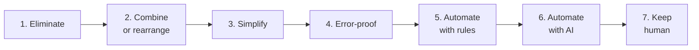
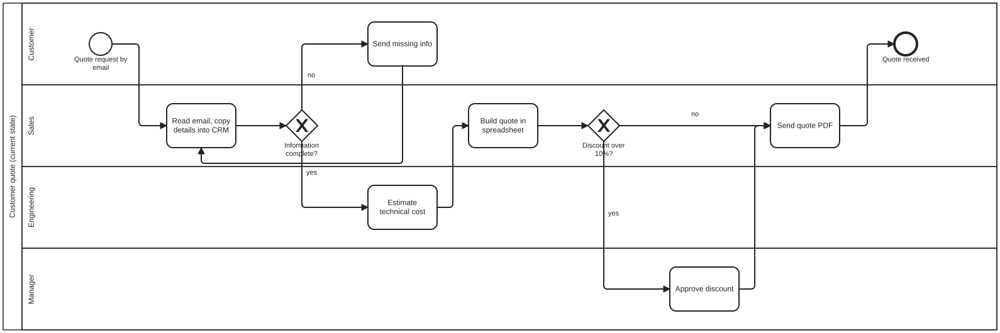

<h1 align="center">Kaizen</h1>

<p align="center"><strong>Stop automating waste.</strong></p>

<p align="center">
  <em>He walks the floor before he touches the keyboard.</em>
</p>

<p align="center">
  
  
  
  
  
</p>

<p align="center"><a href="i18n/README.fr.md">Français</a></p>

---

You know him. Thirty years on factory floors. Before anyone buys a machine, he spends a morning
watching people work, and comes back with a sheet of paper: three steps to delete, one form to
change, and a much smaller machine.

Your AI agent does the opposite. Ask it to "add AI to our support triage" and it starts writing a
classifier. Nobody looked at why triage takes time.

**Kaizen puts him inside your agent.** Before it automates anything, it goes to see the real work,
maps it, finds the waste, fixes the root cause, and only then automates what is left, against a
baseline it can measure.

## The ladder

Every step of a process climbs this ladder, and stops at the first rung that works:



AI is rung 6. Most of the gain is usually on rungs 1 to 4, and needs no code at all.

## Before / after

**The request:** *"We get around 300 support emails a day. Operators read each one, pick a
category and forward it. Can you build an AI that does the triage?"*

**A typical first answer:** a prompt with the categories, an LLM call, an integration with the
ticketing tool.

**With `/kaizen`**, the agent first maps the work and finds that reading takes 3 minutes but
tickets wait hours, because 25 % arrive without the customer number and 20 % go to the wrong team
and come back. Root cause: the contact page is a plain email address. The future state:

| Step | Rung |
|------|------|
| Free-text email | **Error-proof**: a form with customer number and request type required |
| Ask the customer for missing info | **Eliminated** by the required fields |
| Find the customer account | **Rules**: the form passes the number, the lookup is automatic |
| Pick the team | **Rules** for form requests, **AI** only for the emails still in free text |
| Priority | **Rules** for known critical cases, **AI suggestion** confirmed by a person |
| Frequent questions | **Standardize**: 15 reply templates |

Expected: 40 to 55 hours a week recovered before any AI, and an AI scope cut to the 30 % of
requests that really need it. [Full example](examples/support-triage.md).

This example comes from a real project. The AI classifier was built and worked (25 % less operator
time). It was later paused, because better intake and reply templates captured most of the gain
for less. Kaizen puts that conclusion at the start of the project instead of the end.

## The skills

| Command | What it does |
|---------|--------------|
| `/kaizen [lite\|full\|ultra]` | The mode: go see, map, remove waste, fix the root cause, climb the ladder, measure, run the smallest experiment. Outputs a one-screen kaizen sheet. |
| `/kaizen-map` | SIPOC, current-state table with lead time and flow efficiency, Mermaid swimlane, and a **real BPMN 2.0 file** that opens in bpmn.io, Camunda Modeler or Signavio. |
| `/kaizen-waste` | Waste walk with the eight wastes of office work, ranked by hours lost per week, every line backed by evidence. |
| `/kaizen-why` | Root cause analysis: 5 whys with an evidence column, fishbone, containment, correction and prevention (8D style). Works on software bugs too. |
| `/kaizen-roi` | The business case nobody likes to write: the cost of the new system's errors, break-even, the cheaper option, and stop criteria decided in advance. |
| `/kaizen-sop` | Makes it stick: one-page procedure, checklist at the point of use, error-proofing, control plan. |
| `/kaizen-help` | Quick reference. |

Skills also trigger on their own when you describe the task: "can we automate our invoice
approvals?", "map this onboarding process", "why does this keep happening?".

### Levels

| Level | Behavior |
|-------|----------|
| `lite` | Does what you asked, with three lines first: the waste spotted, the rung to try first, the number to measure. |
| `full` | The whole method. Default. |
| `ultra` | Also questions whether the process should exist, and refuses to recommend automation without real data. |

## Real BPMN files, not just pictures

`/kaizen-map` writes the process as a small JSON file and turns it into a BPMN 2.0 diagram with
lanes, gateways and layout:

```bash
python skills/kaizen-map/scripts/to_bpmn.py process.json
```

Open the result in [demo.bpmn.io](https://demo.bpmn.io), Camunda Modeler or Signavio, and keep
working on it like any diagram drawn by hand. Waste notes are exported as task documentation.
Python 3, no package to install. Example: [examples/quote-process](examples/quote-process).

<p align="center">
  
</p>
<p align="center"><sub>Generated by <code>to_bpmn.py</code> from <a href="examples/quote-process/as-is.json">a 10-step JSON file</a>, rendered with bpmn-js.</sub></p>

## Install

**Claude Code**, as a plugin:

```text
/plugin marketplace add Aycotek/kaizen
/plugin install kaizen@kaizen
```

**Claude Code**, manually: copy the folders in `skills/` into `~/.claude/skills/` (all projects)
or `.claude/skills/` (one project).

**Other agents that support Agent Skills**: copy the folders in `skills/` into the agent's skills
directory.

**Agents that read `AGENTS.md`** (Codex, Cursor and others): copy [AGENTS.md](AGENTS.md) to the
root of your project, or append it to yours. It is the condensed method, without the specialized
skills.

## Who it is for

Operations and support leads, consultants, product and project managers, founders, and
developers asked to "just automate" something. Anyone who has seen a tool built for a process
that should have been deleted.

## What Kaizen will not do

- Invent numbers. Unknown figures are marked unknown, with how to measure them.
- Blame people. A waste or a defect is always traced to how the work is set up.
- Remove a control without asking why it exists: safety, compliance and checks added after an
  incident are never cut silently.
- Push AI where a form, a rule or a template does the job.

## Tests

```bash
python -m unittest discover tests
```

The BPMN generator is tested for valid XML, every element drawn, nodes inside their lanes, loops,
invalid input and escaping. Generated files were checked to load without warnings in bpmn-js,
the engine behind bpmn.io and Camunda Modeler (`tests/view_bpmn.html`).

## Contributing

Real examples are the most valuable contribution: a process you improved with Kaizen, with the
before and after numbers. Open an issue or a pull request in [examples/](examples/).

## Author

[Arthur Rolland](https://www.linkedin.com/in/arthur-rolland1/): process and information systems
project manager, Lean Six Sigma Green Belt, BPMN, applied AI. Kaizen packages the method I use on
the floor with operations teams.

MIT license.
