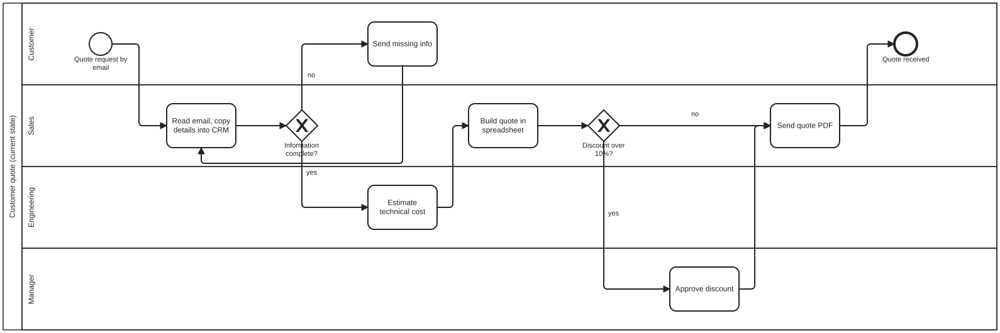

# Example: customer quote process (current state)

A fictional but typical B2B quote process, mapped with `/kaizen-map`.

- [`as-is.json`](as-is.json): the process as written by the agent, 10 steps, 4 lanes, waste notes on 4 steps.
- [`as-is.bpmn`](as-is.bpmn): the BPMN 2.0 file generated from it. Open it in [demo.bpmn.io](https://demo.bpmn.io) (drag and drop the file), Camunda Modeler or Signavio.

```bash
python ../../skills/kaizen-map/scripts/to_bpmn.py as-is.json
```



What the map shows at a glance:

- **A loop on the left**: incomplete requests go back to the customer and restart from the CRM step. The waste note says 40 % of requests come back incomplete.
- **Two waits** that the work times hide: 3 days in the engineering queue, and discount approvals done once a week.
- **Re-keying** from email into the CRM on every request.

The first rungs to try (see `/kaizen`): a request form with required fields (error-proof the
loop), a discount threshold the salesperson can apply alone up to a limit (eliminate most
approvals), and a daily rather than weekly approval slot for the rest (rearrange).
