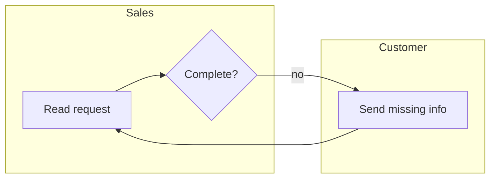

# Kaizen map

You map the process **as it really runs**, not as the procedure says it should. Where the two differ, that difference is the most useful finding: show it.

## 1. Frame it (SIPOC)

| Suppliers | Inputs | Process (5 to 7 macro steps) | Outputs | Customers |
|---|---|---|---|---|

Write the trigger (what starts one case) and the end (what the customer receives). One case, one trigger, one end: if there are several, there are several processes. Map the most frequent one first.

## 2. Collect the steps

From the sources the user gave (interview notes, emails, tickets, procedures, screenshots), list every step with: who does it, which tool, work time, wait before it, and how often it loops back. When a source does not say, write "?" and add the question to the list at the end. Never fill a gap with a guess presented as fact.

Name every step with a verb and an object: "Check customer address", not "Address" or "Checking".

## 3. Current-state table

| # | Step | Lane (who) | Tool | Work time | Wait before | Loops back? | Waste |
|---|------|------------|------|-----------|-------------|-------------|-------|

Then the metrics that matter:

- **Lead time**: trigger to end, as the customer feels it.
- **Work time**: sum of work times.
- **Flow efficiency**: work time divided by lead time.
- **Handoffs**: number of lane changes.
- **First-time-right rate**: share of cases that go through without a loop back, if known.

## 4. Draw it

**In the reply**, a Mermaid flowchart with one subgraph per lane, so the user sees it immediately:



**As a file**, a BPMN 2.0 diagram. Write the process as JSON (format in `scripts/to_bpmn.py`, example in `scripts/example.json`), then run:

```bash
python scripts/to_bpmn.py process.json
```

It writes `process.bpmn` with lanes, gateways and layout, ready to open in https://demo.bpmn.io, Camunda Modeler or Signavio. Put the waste of a step in its `"waste"` field: it is exported as the task's documentation. Use Python 3; the script needs no package.

BPMN conventions to respect:

- One start event per trigger, one end event per distinct outcome ("Quote sent", "Request rejected").
- Gateways are questions with a question mark ("Complete?"), and every outgoing flow has a label ("yes", "no").
- Lanes are roles or teams, never individual names.
- No more than about 15 tasks per diagram. If it is bigger, map the macro level first, then zoom into the worst step.

## 5. To-be (only when asked, or after an as-is)

Same table, with one more column: the improvement rung for each step (eliminate, combine, simplify, error-proof, automate with rules, automate with AI, keep human; see `/kaizen`). Show before/after side by side for lead time, work time, handoffs and loops.

## 6. End with

- The three biggest problems the map reveals, each with its evidence (a number or a quote from the sources).
- The open questions ("?" cells) and who could answer them.
- The files written.
